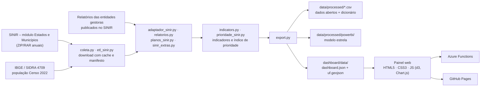

# Objetivos II e III — Dados, tratamento e implementação

Corresponde às seções 4 e 5 do TCC. Recorte: **5.570 municípios e 27 UFs, de 2023 a 2025**, com filtro por região e UF.

## 1. Caracterização e análise dos dados

A pesquisa é aplicada, com objetivos descritivos e exploratórios (Gil, 2008), abordagem quali-quantitativa e procedimento documental associado ao desenvolvimento de um artefato de software. O tratamento segue as etapas do KDD: seleção, pré-processamento, transformação, mineração e interpretação (Fayyad; Piatetsky-Shapiro; Smyth, 1996).

**Pesquisa descritiva não é análise descritiva.** "Descritiva" na classificação da pesquisa se refere aos objetivos (descrever um fenômeno, sem relação de causa e efeito). A **análise descritiva** é a técnica estatística usada na parte quantitativa: contagens, somas, percentuais de cobertura, razões por população e a mediana da coleta per capita entre as UFs. A parte qualitativa é a análise do conteúdo dos planos municipais (seção 2.2 abaixo).

## 2. Arquitetura



## 3. Fontes

| Fonte | Conteúdo usado | Onde está |
|---|---|---|
| SINIR – Módulo Estados e Municípios (2023–2025) | Planos municipais em texto livre, coleta seletiva, plano de gestão, custos do manejo e passivos ambientais | Baixado por `coleta.py` / `etl_sinir.py` para `data/raw/sinir/` |
| Green Eletron – Relatório de resultados EEE 2023 (SINIR) | 1.282 PEVs e 306 municípios, por UF; 4.279,67 t coletadas | `data/raw/sinir/relatorios/green_2023_uf.csv` |
| ABINEE – notícia de 21/08/2025 | Totais nacionais da Green Eletron em 2024: 1.611 PEVs e 366 municípios (sem detalhe por UF; massa não divulgada) | `totais_nacionais.csv` |
| Green Eletron – Relatório anual 2022 (SINIR) | Lista de 266 municípios com seus PEVs, a única lista municipal publicada; usada como "PEV listado" | `green_2022_municipios.csv` |
| IBGE – Censo 2022, SIDRA tabela 4709 | População dos 5.570 municípios (203.080.756 hab.) | `data/raw/ibge/populacao.csv` |
| Malha das UFs (derivada do IBGE) | Polígonos do mapa | `data/raw/geo/` |

A proveniência de cada número (documento, URL e conferência contra os totais impressos) está em `data/raw/sinir/relatorios/fontes.json` e aparece na aba Dados abertos.

**Lacunas no recorte:** a ABREE 2023 remete os números a um anexo não publicado; não há relatórios de 2024 e 2025 no SINIR até 08/10/2026 (para 2024, usam-se os totais da ABINEE). A série 2019–2022 fica disponível trocando `ANO_INICIAL` para 2019 em `config.py`.

## 3.1 Coleta automática

`src/reee/coleta.py` consulta a API CKAN do portal do MMA e seleciona os recursos do módulo Estados e Municípios. `src/reee/etl_sinir.py` lê os ZIPs oficiais do SINIR (fonte principal; o portal do MMA fica como alternativa). Cada download registra URL, data de modificação, tamanho, SHA-256 e data da coleta em `data/raw/sinir/manifesto.json`, e só é refeito quando o arquivo muda na fonte.

`src/reee/adaptador_sinir.py` lê todas as abas de todas as planilhas e decide, por pontuação, a linha de cabeçalho, a coluna de código IBGE e as colunas de eletroeletrônicos. O inventário (`data/processed/inventario_sinir.md`) mostra cada escolha; correções manuais vão em `data/raw/sinir/mapeamento.json`. O inventário confirmou que **o módulo não tem campos numéricos de REEE**: por isso os números vêm dos relatórios das entidades.

## 3.2 Planos municipais: análise de conteúdo

`src/reee/planos_sinir.py` classifica os textos dos planos (metas, programas, soluções e mecanismos de fonte):

| Etapa | Regra |
|---|---|
| Município | `Município Declarante` + `UF Declarante` casados com o IBGE; grafias próximas (≥ 0,88 de semelhança) são aceitas e registradas |
| Cita REEE | eletroeletrônico(s), eletrodoméstico(s), lixo/sucata eletrônica, resíduos/equipamentos eletrônicos, REEE, e-lixo, "eletrônicos" no plural |
| Falsos positivos excluídos | nota fiscal eletrônica, MTR/sistema/meio/processo/documento/ponto eletrônico, entre outros |
| Cita ecoponto/PEV | ecoponto, PEV, ponto de entrega ou de coleta |
| Evidência | trecho de até ~160 caracteres do texto original |

Resultado em 2025: **1.002 municípios declararam** (18 % do total), **15 citam REEE** e **51 preveem ecoponto ou PEV**. Citar não prova execução, e não citar não prova ausência de ação; o painel mostra o trecho para o leitor julgar.

## 4. Regras de tratamento (Pandas)

| Problema encontrado | Regra | Registro em `qualidade.json` |
|---|---|---|
| Encoding latin-1 vs UTF-8 | Tenta UTF-8 com BOM, depois latin-1 | – |
| Separador `;` vs `,` | `csv.Sniffer` sobre os primeiros 5 KB | – |
| Cabeçalhos diferentes, inclusive agrupados | Normaliza (sem acento, minúsculas) e casa com apelidos; grupos viram "Grupo · Coluna" | – |
| Número no formato brasileiro (`1.234,56`) | `numero_br()` converte para float | `massa_valores_invalidos` |
| Código IBGE ausente | Recupera pelo nome + UF, com semelhança mínima de 0,85 | `*_codigo_recuperado_por_nome` |
| Município não identificável | Linha descartada e exemplos listados | `*_sem_municipio_descartados` |
| Município sem informação | Fica nulo, nunca zero | – |
| Massa 0 com pontos > 0 no relatório | Tratada como "sem dado" | – |
| Ano fora do recorte | Removido | `pontos_fora_do_periodo` |
| Valor de massa atípico | Sinalizado (z > 6), **não** removido | `massa_outliers_sinalizados` |

## 5. Indicadores (Quadro 2 do TCC)

| Indicador | Fórmula | Nível |
|---|---|---|
| Pontos exigidos | Σ ⌈população ÷ 25.000⌉ dos municípios com mais de 80 mil hab. | UF, Brasil |
| Pontos informados | Σ pontos declarados pelas entidades gestoras | UF, Brasil |
| Cobertura nominal (%) | pontos informados ÷ pontos exigidos × 100 | UF, Brasil |
| Déficit de pontos | máx(0; exigidos − informados) | município, UF, Brasil |
| Pontos por 100 mil hab. | pontos ÷ população × 100.000 | UF, Brasil |
| Massa per capita (kg/hab.) | t × 1.000 ÷ população | UF, Brasil |
| Planos que citam REEE (%) | planos com menção ÷ planos declarados × 100 | município, UF |
| Índice de prioridade (0–100) | ver 5.1 | município-alvo |

**Corte de 80 mil habitantes.** Pelo art. 48, § 2º, do Decreto 10.240/2020, cada município da lista do Anexo III deve ter ao menos 1 ponto a cada 25 mil habitantes. A lista reúne os cerca de 400 municípios mais populosos, que as entidades descrevem como os de mais de 80 mil habitantes; o painel usa esse corte como aproximação (405 municípios).

**Cobertura nominal.** Compara só quantidades: a soma de relatórios de entidades diferentes pode contar o mesmo local duas vezes, e cumprir o número não garante boa distribuição no território.

### 5.1 Índice de prioridade (dados reais, 2023–2025)

`src/reee/prioridade_sinir.py`, pesos em `PESOS_PRIORIDADE_SINIR` (`config.py`):

```
índice = 100 × ( 0,50 · demanda
               + 0,15 · sem PEV listado
               + 0,10 · sem plano declarado
               + 0,10 · plano não cita REEE
               + 0,05 · sem coleta seletiva
               + 0,05 · plano sem ecoponto/PEV
               + 0,05 · passivo ambiental declarado )
```

- **demanda** = posição percentil dos pontos exigidos entre os municípios-alvo (0 a 1);
- cada **sinal** vale 1 quando presente **ou sem informação**;
- **classes:** alta ≥ 70, média ≥ 55, baixa < 55. Em 2025: 94 alta, 204 média e 107 baixa.

> **Limitação (conclusão do TCC).** Os pesos foram definidos pelo grupo e não passaram por análise de sensibilidade nem por validação com gestores. O ranking não deve ser lido como a prioridade real de cada território.

### 5.2 Simulador de instalação

Percorre os municípios-alvo em ordem de índice e instala em cada um os pontos que faltam antes de passar ao próximo, até esgotar o número escolhido no controle deslizante. Mostra municípios atendidos, quantos passam a cumprir o Decreto, população que ganha o primeiro ponto e déficit restante.

Com dados reais, o déficit é **estimado** como pontos exigidos − PEVs listados (Green Eletron, 2022). Como a ABREE não publica pontos por município, essa é uma estimativa máxima da falta.

### 5.3 Modo demonstração

Com `--demo`, o painel usa dados sintéticos e o índice antigo (`PESOS_PRIORIDADE`: 45 % déficit, 30 % população acima da capacidade da rede, 15 % coleta per capita abaixo da mediana da UF, 10 % ausência de ponto), que depende de pontos por município. Esse modo serve só para testar a interface.

## 6. Implementação do dashboard

- **Sem etapa de build:** HTML5, CSS3 e JavaScript puro; d3 (mapa) e Chart.js (gráficos) via CDN.
- **Três abas,** com filtros globais de ano (2023, 2024, 2025), região e UF:

| Aba | Recursos | Figura do TCC |
|---|---|---|
| Gestor público | Indicadores com selo de fonte, mapa por UF, evolução frente às metas do Decreto, meta em peso, mapa por município, custos do manejo, ranking de prioridade com simulador e filtro de parceria, municípios que pedem atenção, contribuições recebidas | 1 e 2 |
| Cidadão | Busca com sugestões, situação da cidade em linguagem simples, trecho do plano municipal, evolução anual, ficha em PDF, comparação de até 3 cidades, como descartar, formulário de participação | 3 |
| Dados abertos | Funil dos dados do SINIR, CSVs, dicionário de indicadores, proveniência e qualidade dos dados | 4 |

- **Link compartilhável:** ano, filtros, aba, cidade e comparação ficam no endereço; botão "Copiar link desta visão".
- **Acessibilidade:** tema claro/escuro, situação nunca indicada só por cor, navegação por teclado (abas, mapa, busca), tabela de dados de cada gráfico, região de avisos para leitor de tela; verificada com axe-core, sem violações de contraste no nível AA das WCAG.
- **Participação:** o formulário "Participe" grava sugestões e correções sem dados pessoais (`/api/contribuicao` no servidor local e no Azure; no GitHub Pages, só leitura), publicadas em `contribuicoes.csv`.

## 7. Alternativa em Power BI

O pipeline grava um modelo estrela em `data/processed/powerbi/`:

```
dim_municipio (cod_ibge PK) ─┬─< fato_municipio_ano (cod_ibge, ano)
                             └─< fato_ponto_ano     (cod_ibge, ano)
dim_ano (ano PK) ────────────┬─< fato_municipio_ano
                             └─< fato_ponto_ano
```

```dax
Pontos = SUM(fato_municipio_ano[pontos])
Toneladas = SUM(fato_municipio_ano[toneladas])
Populacao = SUM(fato_municipio_ano[populacao])
Pontos por 100 mil = DIVIDE([Pontos], [Populacao]) * 100000
kg por hab = DIVIDE([Toneladas] * 1000, [Populacao])
Meta municipios = MAX(dim_ano[meta_municipios])
Deficit = SUM(fato_municipio_ano[deficit_pontos])
```

Para o ranking com dados reais, importe `prioridade_sinir.csv`.

## 8. Reprodutibilidade

```bash
pip install -r requirements.txt
python iniciar.py                     # coleta se os dados estiverem velhos e abre o painel
python iniciar.py pipeline --coletar  # só coleta e trata
python iniciar.py --demo              # dados sintéticos, sem internet
python -m pytest                      # 66 testes (portal MMA/IBGE simulado e funções do Azure)
```

A cada push, o GitHub Actions roda os 66 testes, refaz a coleta e publica o painel (`pages.yml` e `azure-functions.yml`).
